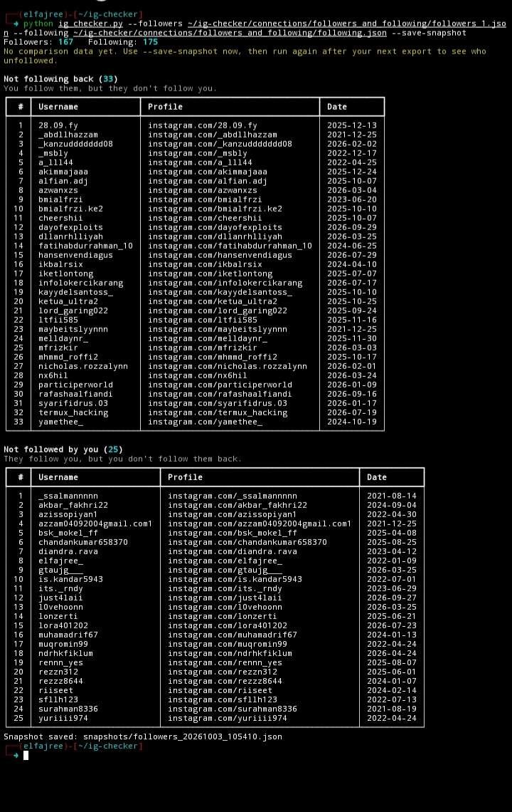

# Instagram Unfollow Checker

A small command-line tool that shows who unfollowed you, who doesn't follow you back, and who you haven't followed back. It works **offline** using your own Instagram data export. No login, no password, no API, no scraping.

## Features

- **Unfollowed**: accounts in your old data that are no longer in your current followers
- **New followers**: accounts that appear in your current followers but not in the old data
- **Not following back**: accounts you follow that don't follow you
- **Not followed by you**: accounts that follow you that you don't follow back
- Snapshots so you can compare against previous runs
- Optional CSV export of every result
- Auto-detects `followers_*.json` and `following.json` in the export folder

## Screenshot

<p align="center">
  
</p>

## Requirements

- Python 3.8+
- [rich](https://github.com/Textualize/rich)

```bash
git clone https://github.com/Elfajree07/ig-checker.git
```

```bash
cd ig-checker
```

```bash
pip install -r requirements.txt
```

## Getting your Instagram data

1. Open Instagram: **Settings → Accounts Center → Your information and permissions → Download your information**.
2. Choose to export **Followers and following**.
3. Select **JSON** as the format (not HTML).
4. Download and extract the ZIP file once it's ready.

## Usage

### Basic: point it at the export folder

```bash
python ig_checker.py path/to/instagram-export
```

Followers and following files are found automatically. This gives you the "not following back" and "not followed by you" lists.

### Detect unfollowers

Unfollowers can only be detected by comparing two points in time. The first time, save a snapshot:

```bash
python ig_checker.py path/to/instagram-export --save-snapshot
```

Later, after downloading a fresh export, run it again. It compares against the latest snapshot automatically:

```bash
python ig_checker.py path/to/new-export --save-snapshot
```

You can also compare against an older export directly:

```bash
python ig_checker.py path/to/new-export --old path/to/old-export/followers_1.json
```

### Export results to CSV

```bash
python ig_checker.py path/to/instagram-export --csv results/
```

This creates `unfollowed.csv`, `new_followers.csv`, `not_following_back.csv`, and `not_followed_by_you.csv` (only the ones relevant to your data).

### Specify files manually

```bash
python ig_checker.py --followers followers_1.json followers_2.json --following following.json
```

## Options

| Option | Description |
|---|---|
| `data_dir` | Extracted Instagram export folder (optional if using `--followers`) |
| `--followers FILE [FILE ...]` | One or more `followers_*.json` files |
| `--following FILE` | The `following.json` file |
| `--old FILE [FILE ...]` | Older followers data (previous export or snapshot) |
| `--snapshot-dir DIR` | Snapshot folder (default: `./snapshots`) |
| `--save-snapshot` | Save the current followers as a snapshot |
| `--csv FOLDER` | Save results as CSV files in this folder |

## Notes

- An account listed as "unfollowed" may have been **deleted, deactivated, or renamed** rather than having unfollowed you.
- The "Date" column is the timestamp stored in the Instagram export (usually when the follow happened). Snapshots don't store dates, so they show `-`.
- Everything runs locally. Your data never leaves your machine.
- Only use this with your own data export.

## License

MIT

## Contact me

[](https://wa.me/62895339571001)
[](https://instagram.com/fadhlii.xploits)


